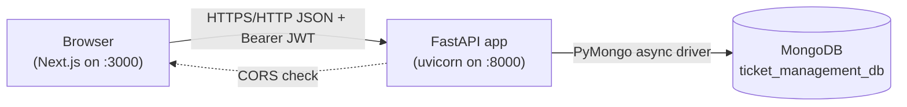
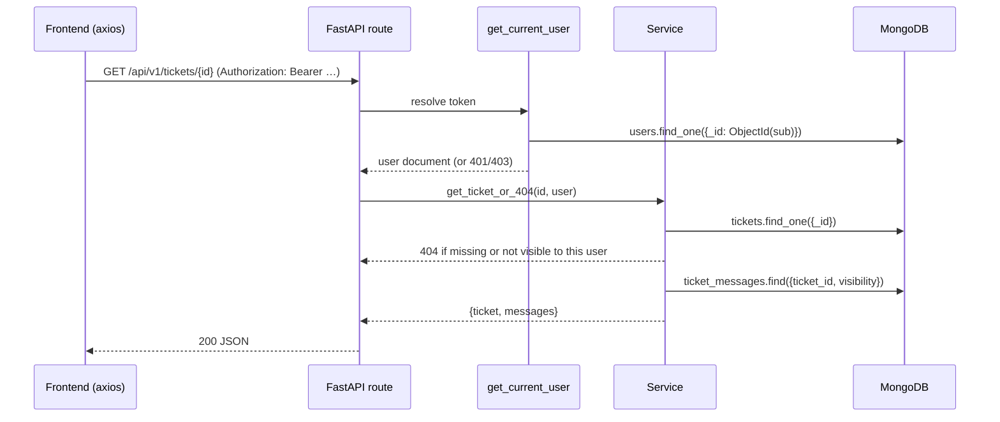
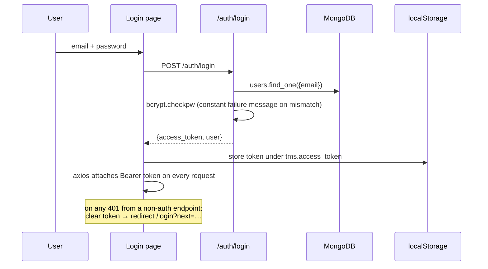
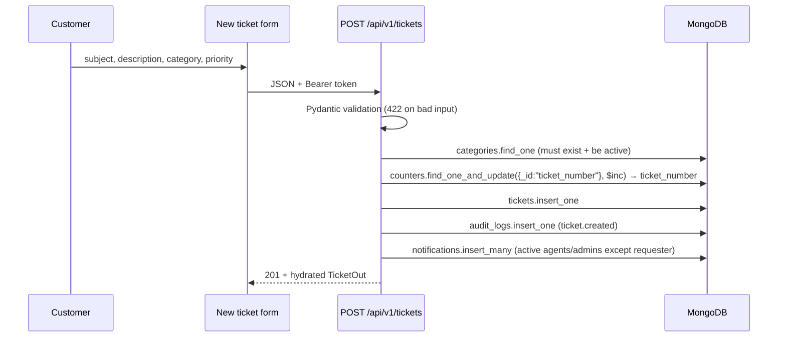

# Architecture

DeskFlow is a classic three-tier web application: a Next.js single-page-style frontend
in the browser, a FastAPI REST backend, and MongoDB. There is no other middleware — no
message queue, no cache, no separate auth server.

## System context



- **Frontend** (`frontend/`): Next.js 15 App Router, React 19, TypeScript strict. All
  data comes from the API — there is no mock data and no client-side fabrication of
  metrics.
- **Backend** (`backend/`): FastAPI, versioned under `/api/v1`. Stateless: every
  request carries a JWT; the server holds no session state.
- **Database**: MongoDB, database name `ticket_management_db` (configurable via
  `MONGO_DB`). Seven collections; see [DATABASE.md](DATABASE.md).

## Backend internal structure

```
HTTP request
   │
   ▼
app/main.py ──────── CORS middleware → exception handlers → router
   │
   ▼
app/api/v1/*  ────── FastAPI routers: validate input (Pydantic), pick status codes
   │                  dependencies: get_current_user / require_admin …
   ▼
app/services/* ───── business rules: visibility, state machine, notifications, audit
   │
   ▼
app/db/mongo.py ──── AsyncMongoClient handle (created at startup, closed at shutdown)
   │
   ▼
MongoDB
```

Layering rules (see [BACKEND_GUIDE.md](BACKEND_GUIDE.md)):

1. **Routers** (`app/api/v1/`) own HTTP concerns: query/body models, status codes,
   response models for accurate OpenAPI.
2. **Services** (`app/services/`) own business rules and are unit-testable without
   HTTP: ticket visibility, status transitions, assignment validation, notification
   and audit side effects.
3. **Serialization** (`app/utils/serialize.py`) converts Mongo documents (with
   `ObjectId` keys) into plain response dicts; ids are lowercase hex strings.
4. **Dependencies** (`app/dependencies/auth.py`) resolve the bearer token into a user
   document and enforce role gates.

There is deliberately **no repository layer** — services query collections directly
through the shared async database handle. This keeps the code small and readable; a
repository would add indirection without a second persistence target to justify it.

## Request lifecycle (authenticated call)



Errors at any step produce the standard envelope `{"detail": "…"}` (or a validation
array for 422) — see [API_DOCUMENTATION.md](API_DOCUMENTATION.md#error-responses).

## Authentication flow



## Ticket creation flow



Notification and audit writes are best-effort: a failure there is logged server-side
and never fails the user's request.

## Frontend structure & data flow

- Route groups: public pages (`/`, `/login`, `/register`) and the authenticated
  `(app)` group wrapped in `RequireAuth` + `AppShell`; `/admin/*` is additionally
  wrapped in `RequireRole(["admin"])`.
- Every fetch goes through `services/*` → axios instance (`lib/api-client.ts`) which
  attaches the token, enforces a 15 s timeout, and normalizes failures into
  `ApiError` (message + field errors).
- Pages use the `useApi` hook for loading/error/retry state; each data region renders
  independently (one failing call doesn't blank the page).
- Enums and labels live in one place each: values in `types/`, display labels/colors
  in `lib/constants.ts` — both mirror the backend enums exactly.

## Data ownership summary

| Data | Written by | Read by |
|---|---|---|
| `users` | register (customer), admin CLI/endpoint | self, admins, hydration joins |
| `tickets` | any authenticated user (create), agents/admins (status/assign) | role-scoped |
| `ticket_messages` | participants; internal notes staff-only | role-filtered (internal hidden from customers) |
| `categories` | admins | all authenticated (active only, unless admin) |
| `notifications` | server-side events | owner only |
| `audit_logs` | server-side (never the client) | admins only |
| `counters` | server-side ticket numbering | — (internal) |

## Deployment topology (development)

| Process | Command | Port |
|---|---|---|
| MongoDB | `mongod --dbpath …` | 27017 |
| Backend | `python -m uvicorn app.main:app --reload` | 8000 |
| Frontend | `npm run dev` (Turbopack) | 3000 |

Production considerations are in [DEPLOYMENT_GUIDE.md](DEPLOYMENT_GUIDE.md). Note that
the frontend must be **static-exportable or SSR-hosted behind the same origin story as
the API** — it is a standard Next.js app, not an edge app; nothing in this project is
verified on serverless/edge runtimes.
