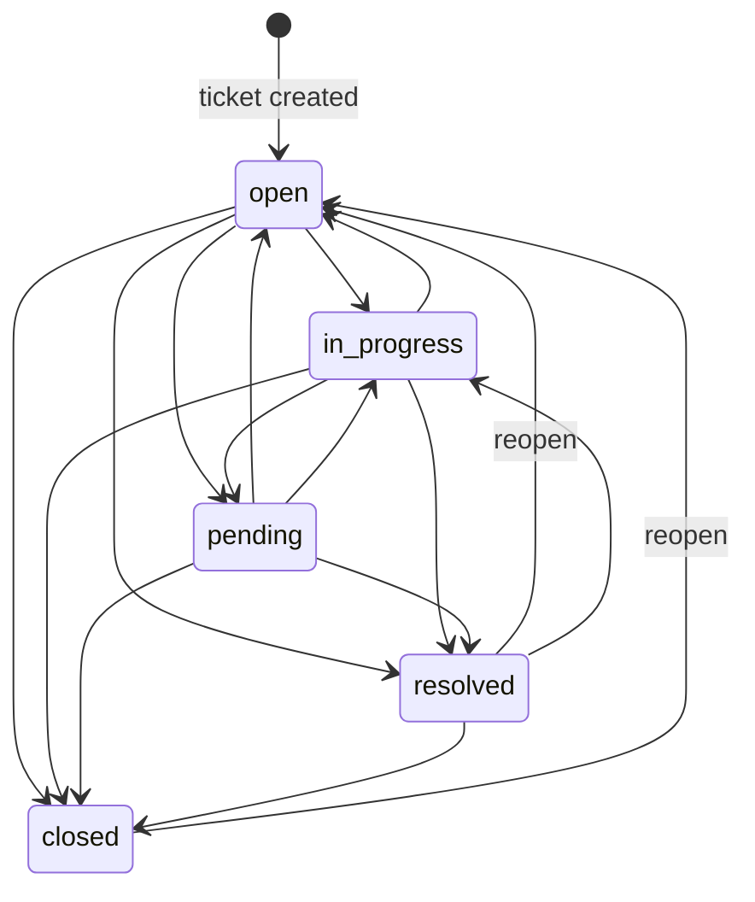

# Ticket Workflow

The real lifecycle implemented in `backend/app/services/tickets.py` and
`backend/app/models/enums.py` — this is what the code enforces, verified by tests.

## Status values

| Status | Meaning (as used by the product) |
|---|---|
| `open` | New / awaiting first handling |
| `in_progress` | An agent is actively working it |
| `pending` | Waiting on something (customer reply, third party, vendor) |
| `resolved` | Work is done (customer may still reopen via reply → staff reopen) |
| `closed` | Terminal; only a reopen (`→ open`) is allowed afterwards |

## Transition rules

State machine (server-validated on every status change):

- Transition set is defined once in `ALLOWED_TRANSITIONS`; an illegal jump (e.g.
  `closed → pending`, `closed → resolved`) returns **400**
  `"Cannot change status from 'X' to 'Y'."`
- Setting the **same** status again is a no-op (200, no audit noise).
- Only **agents and admins** may change status. A customer sending `status` in
  `PATCH /tickets/{id}` receives **403**.

## Creation

- Any authenticated user creates a ticket; `requester_id` is taken from the token —
  never from the request body.
- Required: `subject` (1–200), `description` (1–10 000), `category_id` (existing **and
  active**; inactive → 400, unknown → 404), `priority` (enum).
- New tickets start at `status: "open"`, `assignee_id: null`, and receive a
  sequential human-readable `ticket_number` (atomic `$inc` on the `counters`
  collection).
- Side effects: an audit entry (`ticket.created`) and an in-app notification to every
  active agent/admin **except the requester** (see [NOTIFICATIONS.md](NOTIFICATIONS.md)).

## Editing (subject, description, priority, category)

- **Customer**: only their own ticket, and only while status ∈
  {open, in_progress, pending}. Editing a resolved/closed ticket → **400**
  ("…no longer be edited"). Changing status in the same request → **403**.
- **Agent/Admin**: any visible ticket (admin: any ticket), any field, any status the
  state machine allows.
- Only fields that actually changed are written; `updated_at` is bumped; the change
  set is recorded in the audit log (`ticket.updated`, e.g. `"Customer updated:
  subject, priority"`).

## Assignment

- Endpoint: `POST /tickets/{id}/assign` with `{ "assignee_id": "<hex>" }` — or
  `null` to **unassign**.
- Who: **agents and admins only** (customers → 403).
- To whom: the assignee must be an **active** user whose role is `agent` or `admin`;
  assigning to a customer or a deactivated account → **400**
  ("Tickets can only be assigned to agents or admins.").
- Common flows: agent self-assign ("Assign to me"), agent unassign, admin reassign to
  any team member (the frontend admin picker is fed by `GET /users?role=agent`).
- Side effects: audit entries `ticket.assigned` / `ticket.unassigned`; a notification
  to the new assignee when it differs from the actor.

### Who can see which tickets (the "queue rules")

| Role | Sees |
|---|---|
| Customer | Tickets where they are the requester |
| Agent | Their own (as requester) + tickets assigned to them + **unassigned tickets** (the shared queue) |
| Admin | Everything |

A ticket assigned to *another* agent disappears from your queue — this is tested
(`test_agent_sees_unassigned_queue_and_assigned`).

## Replies and internal notes

- `POST /tickets/{id}/messages` with `{ "body", "visibility" }`.
- `visibility: "public"` — the normal conversation. Allowed for any participant
  (customer on own tickets; staff on visible tickets). Body 1–10 000 chars,
  whitespace-only rejected (422).
- `visibility: "internal"` — **agent/admin only** (customer → 403). Notes are:
  - stored in the same `ticket_messages` collection with the visibility flag;
  - **stripped from every response a customer receives** (the message query filters
    `visibility: "public"` whenever the viewer is a customer) — not merely hidden in
    the UI;
  - excluded from reply notifications to customers.
- Every successful message bumps the ticket's `message_count` and `updated_at`.
- Messages are returned in chronological order (`created_at` ascending).
- There is **no auto-reopen on customer reply** — a customer replying to a closed
  ticket does not change its status; staff can reopen it explicitly (`closed → open`).

## Status changes and notifications

When an agent/admin changes status, the **requester** receives an in-app
notification (unless they made the change themselves):
`"Your ticket 'X' is now in progress."`

## Audit trail for a ticket

Every lifecycle event lands in `audit_logs` (admin-readable):

| Event | Action name | `details` example |
|---|---|---|
| Created | `ticket.created` | `Ticket #42 created` |
| Fields edited | `ticket.updated` | `Customer updated: subject, priority` |
| Status changed | `ticket.status_changed` | `open -> in_progress` |
| Assigned / unassigned | `ticket.assigned` / `ticket.unassigned` | `Assignee set to 65f0…` |
| Message posted | `ticket.message_added` | `agent added a internal note` |

## Edge cases & guards (implemented)

| Case | Behavior |
|---|---|
| PATCH with no fields | 422 ("Provide at least one field to update.") |
| Malformed ObjectIds in bodies | 422; in path params → 404 |
| Category deactivated after tickets reference it | Old tickets keep the category; new tickets cannot use it |
| Assignee deactivated later | Ticket keeps the reference (no cascade); admin can reassign |
| Concurrent status updates | Last write wins (no optimistic locking — documented limitation) |
| Customer edits during `pending` | Allowed (only resolved/closed block them) |
